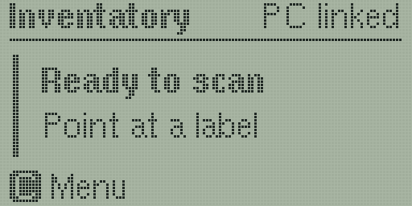

<div align="center">

<a href="https://kwiatens.github.io/Inventatory-Site/">
  
</a>


### Scan the bag. Stay at the bench.

**Open-source firmware for the Inventatory Scanner R1, the handheld scanner for the
[Inventatory](https://github.com/Kwiatens/Inventatory-Software) parts inventory.**


[](LICENSE)


[**Website**](https://kwiatens.github.io/Inventatory-Site/) &nbsp;·&nbsp;
[Software](https://github.com/Kwiatens/Inventatory-Software) &nbsp;·&nbsp;
[Scanner guide](https://kwiatens.github.io/Inventatory-Site/docs/scanner/) &nbsp;·&nbsp;
[Report an issue](https://github.com/Kwiatens/Inventatory-Firmware/issues)

<br>


&nbsp;


</div>

---

> **Status:** pre-release (`0.1.0`, see [CHANGELOG.md](CHANGELOG.md)).

## Why a scanner

Inventatory works fully without it. The Scanner R1 takes the computer out of the loop while you work at the bench.

|  | Without the scanner | With the Scanner R1 |
| --- | --- | --- |
| **New parts arrive** | Type the part number, or load the order CSV, at the PC | Scan each bag: the part is filled in, labelled and given a slot |
| **Taking parts out** | Walk to the PC and change the count | Scan the part's label and type how many on the keypad |
| **Cable labels** | Print from the PC | Pick a preset on the scanner and it prints |
| **PC asleep or away** | Wait | Scans are kept on the scanner and sent when the PC is back |

## What it does

- **Reads vendor bags.** The Data Matrix on DigiKey and Mouser bags and the QR code on TME bags, plus the labels
  Inventatory prints for your parts.
- **Adds and removes stock** from the keypad, with the result on its 128 × 64 screen.
- **Prints labels** through the printer on your PC, including up to twelve cable-flag presets.
- **Keeps your scans safe.** Each scan is stored on the scanner before it is sent, and survives Wi-Fi drops,
  restarts and power loss. A scan that can't be stored is never shown as saved.
- **Pairs safely.** Setup uses Bluetooth with a six-digit code shown on the screen. After that, every request
  between the scanner and the PC is authenticated, and replayed requests are refused.
- **Updates over Wi-Fi** with signed firmware only. A USB flash always works.
- **Runs on a battery** with a charging dock, a battery gauge and energy saving.

## Hardware

| Part | Used |
| --- | --- |
| Board | Waveshare ESP32-S3-Nano (16 MB flash) |
| Scan engine | GM65 1D/2D barcode module |
| Screen | 128 × 64 ST7565 LCD (GMG12864-06D) |
| Keys | 4 × 4 keypad |
| Power | Li-ion cell with a charger module and dock |

The enclosure and charging dock are designed for 3D printing. Build it from the open files, design your own
enclosure, or get the official CAD files from the [website](https://kwiatens.github.io/Inventatory-Site/) to
support the project. Wiring is in [docs/wiring.md](docs/wiring.md).

## Build the scanner

Visit the [**website**](https://kwiatens.github.io/Inventatory-Site/) for guides on building and setting up the
scanner. The sections below are only needed if you compile the firmware yourself.

## Build

Use PlatformIO. Create the private configuration from the tracked example, then build. On Windows, use `Copy-Item` instead of `cp`.

```bash
cp src/config/config.example.h src/config/config.h
pio run -e waveshare_esp32s3_nano_usb
```

Flash over USB with `pio run -e waveshare_esp32s3_nano_usb -t upload`. USB always works, whatever is installed.
Updates over Wi-Fi install only packages signed by a key in `src/config/ota_keys.h`. If you build your own
firmware, put your own public key there and sign with `tools/sign_firmware.py`; see
[docs/ota-protocol.md](docs/ota-protocol.md).

## Test

The host suite runs on any machine with a C++17 compiler and OpenSSL headers. It needs no device.
The layers, the commands and how to add a test are in [docs/testing.md](docs/testing.md).

```bash
make -C host-tests test
pio test -e waveshare_esp32s3_nano_usb --without-uploading --without-testing
```

## Documentation

- [Contributing](CONTRIBUTING.md)
- [Security](SECURITY.md)
- [Architecture and invariants](AGENTS.md), also the guide for coding agents
- [Changelog](CHANGELOG.md)
- [Release steps](docs/releasing.md)
- [Signed updates over Wi-Fi](docs/ota-protocol.md): package format and the pull protocol the desktop follows
- [Wiring notes](docs/wiring.md), including the GM65 cable colour warning

## License

GPL-3.0-only. See [LICENSE](LICENSE). Dependency licenses are here [THIRD_PARTY_NOTICES.md](THIRD_PARTY_NOTICES.md).
